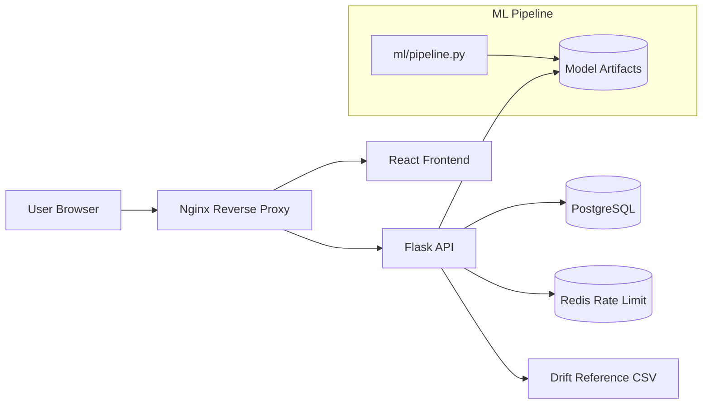
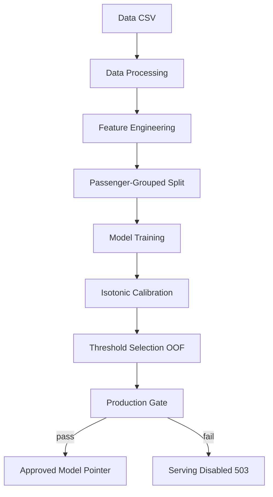

# ✈️ Airline No-Show Prediction System

<div align="center">


**An ML-powered aviation decision-support prototype for passenger no-show prediction, analytics, explainability, and overbooking simulation.**

</div>

---

## 1. Project Title and Introduction

The **Airline No-Show Prediction System** is a full-stack machine-learning prototype that combines a Flask REST API, a React/TypeScript dashboard, a PostgreSQL analytical database, and a rigorous ML training pipeline. It predicts the probability that a booked passenger will not show up, exposes analytics and SHAP-based explanations, simulates overbooking scenarios, and monitors feature drift — while enforcing a fail-closed production approval gate so no unapproved model can serve predictions.

## 2. Project Overview

- **Domain:** Aviation revenue-management / decision support
- **Status:** Research prototype. No model currently passes the production approval gate, so `/api/predict` and `/api/bulk-predict` return HTTP 503 by design.
- **Stack:** Python 3.11, Flask 3, SQLAlchemy 2, PostgreSQL 15, React 18, Vite 6, TailwindCSS 3, Docker, AWS ECS Fargate.
- **ML:** Logistic Regression, Random Forest, XGBoost, LightGBM, Gradient Boosting with passenger-grouped cross-validation, isotonic calibration, and F1 threshold selection on out-of-fold predictions.

## 3. Problem Statement

Airline no-shows leave seats empty that could have been sold and create operational inefficiency. This system provides prototype risk scoring and decision-support analysis (scenario evaluation, risk review, historical pattern exploration) over a supplied 3,000-row dataset with 36.2% no-show prevalence. It is **not** an operational recommendation engine.

## 4. Project Objectives

- Build a leakage-aware no-show prediction pipeline with passenger-grouped validation.
- Provide an analytics dashboard for route, channel, and temporal performance.
- Offer SHAP-based local and global explainability for the approved model.
- Simulate overbooking scenarios with configurable cost parameters.
- Monitor feature drift against the training reference.
- Enforce a fail-closed production approval gate.

## 5. Key Features

- 🔐 JWT authentication via HttpOnly cookies with CSRF protection and RBAC
- 🎯 Single and batch prediction (max 1000) with persistence
- 📊 Analytics: overview, routes, channels, trends, high-risk bookings (admin)
- 💰 Monte Carlo overbooking simulator with cost parameters
- 🔍 Feature-drift monitoring (PSI + KS) with severity bands
- 🧠 SHAP local explanations per prediction + global importance
- 🛡️ Production config validation (secrets, Postgres, rate-limit storage, proxy hops)
- 🐳 Docker Compose + AWS ECS Fargate deployment templates

## 6. Screenshots and Demo Section

Screenshots captured from the running local React + Flask apps (empty local DB during validation):


> Missing screenshots (to be captured): Analytics, Overbooking, Models, Login, and mobile views. **Requires verification** against a running instance.

## 7. System Architecture





## 8. Technology Stack

| Layer | Technologies |
|-------|-------------|
| Backend | Python 3.11, Flask 3, Flask-SQLAlchemy, Flask-JWT-Extended, Flask-Limiter, Flask-CORS, Gunicorn |
| ML | scikit-learn, XGBoost, LightGBM, SHAP, pandas, numpy, scipy |
| Frontend | React 18, TypeScript 5, Vite 6, React Router 7, Axios, Recharts, TailwindCSS 3 |
| Database | PostgreSQL 15 (prod), SQLite (dev), Redis (rate limiting) |
| Deployment | Docker, Docker Compose, Nginx, AWS ECS Fargate, CloudFormation |
| Testing | pytest, Playwright |

## 9. Machine Learning Workflow

1. **Data ingestion** — load `data/training_data.csv`
2. **Preprocessing** — cleaning, encoding, passenger-grouped split (80/20, seed 42)
3. **Feature engineering** — 54 columns from booking/flight inputs; passenger-history aggregates excluded
4. **Training** — 5 models with small hyperparameter grids, 5-fold `StratifiedGroupKFold`
5. **Calibration** — isotonic regression on out-of-fold predictions
6. **Threshold selection** — F1 threshold on calibrated OOF probabilities (advisory)
7. **Evaluation** — held-out test metrics (separate from CV)
8. **Production gate** — ROC-AUC > 0.70, F1 > 0.50, precision > 0.50, recall > 0.50, PR-AUC > prevalence
9. **Serving** — only the artifact named by an approved `production_model.json` pointer

## 10. Algorithms Used

| Algorithm | Purpose |
|-----------|---------|
| Logistic Regression | Baseline linear model |
| Random Forest | Ensemble tree model |
| XGBoost | Gradient boosting (selected by CV PR-AUC) |
| LightGBM | Gradient boosting |
| Gradient Boosting | sklearn ensemble |
| Isotonic Regression | Probability calibration |
| SHAP (Tree/Linear/Kernel) | Explainability |
| Monte Carlo (Binomial) | Overbooking simulation |
| PSI + KS test | Drift detection |

## 11. Model Evaluation and Performance Metrics

Metrics computed by the pipeline: accuracy, precision, recall, F1, ROC-AUC, PR-AUC (average precision), specificity, NPV, FPR, FNR, confusion matrix, Brier score, log loss, ECE, MCE, calibration curves.

The checked-in artifacts (`models/*_info.json`, version 20261120) report poor discrimination (ROC-AUC 0.58–0.64) and none pass the production gate (threshold 0.70). The leakage-aware grouped experiment (documented in `dataset-research-report.md`) shows near-chance ROC-AUC (~0.50). **No model is approved for serving.**

> **Requires verification:** the exact numbers above come from committed JSON artifacts and the dataset research report; re-running the pipeline may produce different values depending on data and seed.

## 12. Explainable AI (SHAP)

- **Global importance:** `GET /api/explainability/global` — SHAP importance computed on the training reference CSV.
- **Local explanations:** returned per prediction in `/api/predict` and `/api/bulk-predict` responses.
- Available only for the approved serving model; unavailable while serving is disabled.

## 13. Analytics Dashboard

Pages: Login, Dashboard, Prediction, Analytics, Overbooking, Models. Charts via Recharts (route performance, channel performance, time trends, no-show distribution). High-risk bookings endpoint is admin-only; ordinary users receive a permission message.

## 14. Overbooking Simulation

`POST /api/overbooking/simulate` runs a Monte Carlo binomial simulation comparing scenarios with configurable cost parameters (compensation, empty-seat, denied-boarding costs). Returns risk categories, expected revenue/cost/profit, denied boardings, empty seats, and a risk-adjusted strategy. Explicitly labeled as not an operational recommendation.

## 15. Data Drift Monitoring

`GET /api/monitoring/drift` computes PSI and KS statistics per feature against `data/training_data.csv`, assigns severity (low/medium/high/critical), and evaluates labeled-outcome performance (accuracy, precision, recall, F1, ROC-AUC, PR-AUC, Brier). Prediction drift is reported as `unknown` (no historical prediction-probability baseline available). Results are persisted to `monitoring_logs`.

## 16. Database Architecture

**ORM (SQLAlchemy)** — 7 tables with UUID primary keys: `passengers`, `flights`, `bookings`, `predictions`, `model_performance`, `users`, `monitoring_logs`.

**PostgreSQL schema (sql/)** — richer DDL: extra columns (`date_of_birth`, `total_flights`, `aircraft_type`, `baggage_included`, `seat_number`, `check_in_status`), `booking_history` audit table, 8+ analytical views, stored procedures/functions/triggers, and 15 analytics functions. Migration runner applies `schema.sql → views.sql → analytics.sql`.

> **Inconsistency (documented):** ORM columns are a subset of the SQL schema; many SQL views/functions are defined but never called by the Flask app.

## 17. API Documentation

| Method | Path | Auth | Description |
|--------|------|------|-------------|
| GET | `/` | none | Index metadata |
| GET | `/api/docs` | none | Endpoint listing |
| GET | `/api/health` | none | DB + model status |
| GET | `/api/health/detailed` | none | Detailed components |
| POST | `/api/auth/register` | none | Gated by `ALLOW_PUBLIC_REGISTRATION` |
| POST | `/api/auth/login` | none | Sets HttpOnly cookie + CSRF |
| POST | `/api/auth/logout` | JWT | CSRF-protected |
| GET | `/api/auth/profile` | JWT | Current user |
| POST | `/api/predict` | JWT | Single prediction (503 if no approved model) |
| POST | `/api/bulk-predict` | JWT | Batch (max 1000) |
| GET | `/api/models` | JWT | Loaded model info |
| GET | `/api/analytics/overview` | JWT | `days` 1–365 |
| GET | `/api/analytics/routes` | JWT | Optional `route` |
| GET | `/api/analytics/trends` | JWT | `group_by` day/week/month |
| GET | `/api/analytics/channels` | JWT | Channel performance |
| GET | `/api/analytics/high-risk` | admin | `min_probability`, `limit` |
| GET | `/api/models/performance` | JWT | Reads `*_info.json` |
| GET | `/api/explainability/global` | JWT | SHAP global importance |
| POST | `/api/overbooking/simulate` | JWT | Monte Carlo simulation |
| GET | `/api/monitoring/drift` | JWT | Drift report |

**Example — login:**
```bash
curl -X POST http://localhost:5000/api/auth/login \
  -H "Content-Type: application/json" \
  -d '{"username":"admin","password":"..."}' \
  -c cookies.txt
```

**Example — predict:**
```bash
curl -X POST http://localhost:5000/api/predict \
  -H "Content-Type: application/json" \
  -H "X-CSRF-TOKEN: <csrf_token>" \
  -b cookies.txt \
  -d '{"booking_data":{"booking_date":"2026-11-22","flight_date":"2026-12-06","departure_airport":"JFK","arrival_airport":"LAX","booking_channel_encoded":0,"cabin_class_encoded":0,"ticket_price":350,"loyalty_tier_encoded":1}}'
```

## 18. Project Folder Structure

```
airline-no-show-prediction/
├── backend/          # Flask API (app/, run.py, migrate.py, create_admin.py)
├── frontend/         # React + TypeScript (src/, e2e/)
├── ml/               # ML pipeline (training, evaluation, feature engineering, drift)
├── sql/              # schema.sql, views.sql, analytics.sql, bootstrap_roles.sql
├── models/           # Trained artifacts (*.pkl, *_info.json, *_features.json)
├── data/             # training_data.csv
├── docker/           # Dockerfiles, nginx, postgres bootstrap
├── deployment/       # AWS ECS Fargate CloudFormation
├── tests/            # pytest suite
├── app.py            # Legacy Streamlit dashboard (not supported stack)
├── requirements.txt  # Root deps (includes unused Streamlit/Sphinx)
├── backend/requirements.txt  # Production backend deps
└── docker-compose.yml
```

## 19. Installation and Setup

### Prerequisites
- Python 3.11+, Node.js 20+, PostgreSQL 15+ (or Docker)

### Windows (PowerShell)
```powershell
py -3.12 -m venv .venv
.\.venv\Scripts\Activate.ps1
python -m pip install -r backend\requirements.txt
$env:FLASK_ENV = "development"
python backend\run.py
```

### Linux / macOS
```bash
python3 -m venv .venv
source .venv/bin/activate
pip install -r backend/requirements.txt
FLASK_ENV=development python backend/run.py
```

### Frontend
```bash
npm --prefix frontend ci
npm --prefix frontend run dev
```

### Docker
```bash
cp .env.example .env
# Replace all secret placeholders in .env
docker compose up --build -d
```

### First admin user
```bash
python backend/create_admin.py
```

## 20. Environment Variables

See `.env.example`. Key variables: `FLASK_ENV`, `SECRET_KEY`, `JWT_SECRET_KEY` (≥32 chars in prod), `DB_TYPE`, `DB_HOST`, `DB_PORT`, `DB_NAME`, `DB_USER`, `DB_PASSWORD`, `RATELIMIT_STORAGE_URI`, `TRUSTED_PROXY_HOPS`, `ALLOW_PUBLIC_REGISTRATION`, `AUTO_CREATE_SCHEMA`, `MODEL_DIR`. Production requires PostgreSQL and shared Redis rate-limit storage.

## 21. How to Run the Application

- Backend: `python backend/run.py` (dev) or via Docker.
- Frontend: `npm --prefix frontend run dev` → http://localhost:3000
- API docs: http://localhost:5000/api/docs
- Docker: frontend at http://localhost, API proxied through frontend.

## 22. Testing Instructions

```bash
python -m pytest -q
npm --prefix frontend run build
npm --prefix frontend run test:e2e   # requires running backend + frontend
```

## 23. Deployment Instructions

Docker Compose (local) and AWS ECS Fargate (CloudFormation template in `deployment/aws/ecs-fargate.yml`). Backend runs as non-root (UID 10001). Production requires HTTPS, secret injection via secret store, and a one-off migration task. See README's production checklist (original) — **requires verification** against live infrastructure; the template has not been deployed/validated.

## 24. Limitations

- No approved production model → predictions return 503.
- Checked-in model artifacts use unverified passenger-history features the loader rejects.
- `get_passenger_summary` is a stub; no `/analytics/passengers` backend route despite frontend client method.
- Prediction drift not computed (no historical prediction baseline).
- Many SQL views/functions defined but unused by the app.
- Two divergent requirement files; legacy Streamlit `app.py` unused.
- Duplicate/legacy ML modules (`ml/training.py`, `ml/evaluation.py`, `ml/data_processing.py`, `ml/feature_engineering.py`, `ml/drift_detection.py`) coexist with package versions; package versions are authoritative.
- No LICENSE file present despite MIT claim; no CI config; no `.dockerignore`; weak test isolation.

## 25. Future Enhancements

- Approve a model that passes the production gate (none currently do).
- Remove legacy duplicate ML modules and Streamlit app.
- Implement passenger summary endpoint and align frontend client.
- Add CI/CD, unit tests for frontend, and test isolation (conftest).
- Persist prediction-probability history for prediction-drift monitoring.
- Add `.dockerignore` and a LICENSE file.

## 26. Author Information

- GitHub: [@samalarakshithbabu](https://github.com/samalarakshithbabu)
- Repository: https://github.com/samalarakshithbabu/Airline-No-Show-Prediction-System

## 27. License

MIT License (claimed; no LICENSE file present in repository — **requires verification**).

---

## Documentation Inconsistencies (verified)

1. `README` (original) claimed MIT License but no LICENSE file exists.
2. Original README claimed model performance numbers from a leakage-prone row-random split; the grouped-CV results are near chance. Metrics above reflect committed artifacts only.
3. ORM schema is a subset of `sql/schema.sql` (missing columns, audit table).
4. `v_feature_importance_tracking` expects JSON shape never produced by pipeline.
5. Frontend `getPassengerAnalytics` calls nonexistent `/analytics/passengers`.
6. `ml/training.py` vs `ml/training/`, `ml/evaluation.py` vs `ml/evaluation/` have incompatible APIs; package versions are authoritative.
7. `backend/requirements.txt` vs root `requirements.txt` diverge (root includes unused Streamlit/Sphinx).
8. `schemas.py` `create_tables()` / `__main__` reference non-existent imports (`db`, `engine`).
9. `add_test_data.py` uses legacy `id` PK and SQLite syntax.
10. `connection.py` `create_database_backup` references `SQLITE_DB_PATH` env var not defined in config.

## Features Needing Further Implementation

- Passenger summary/detail endpoints
- `/analytics/passengers` backend route
- Prediction-drift monitoring
- Model retraining automation/scheduler
- Removal of legacy duplicate modules
- CI/CD and frontend unit tests
- LICENSE file and `.dockerignore`