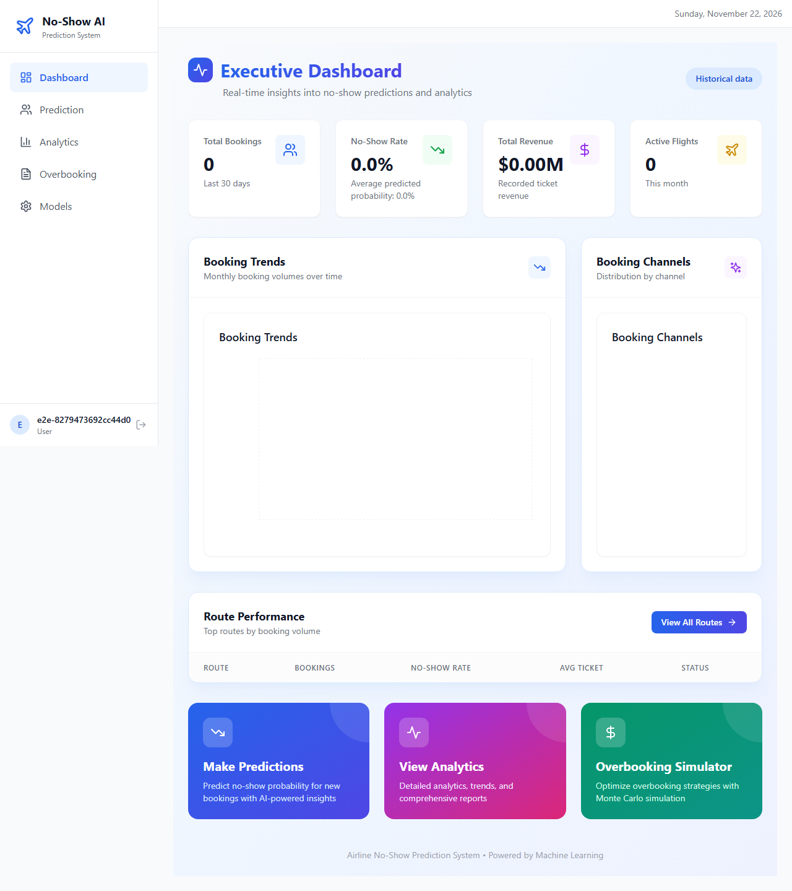
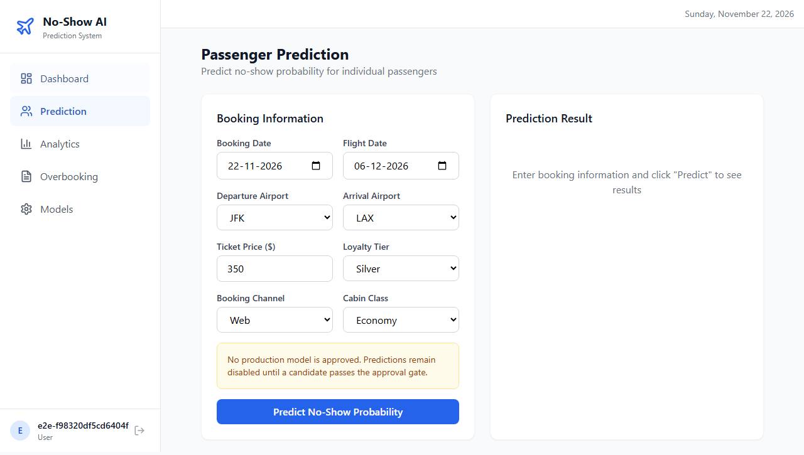

# ✈️ Airline No-Show Prediction System

<div align="center">


**An ML-powered airline passenger no-show prediction prototype with analytics, explainability, and decision-support tools.**

</div>

---

## 🎯 Model Performance

The latest leakage-aware evaluation used passenger-grouped validation. The held-out test prevalence was 36.17%; the constant-prevalence Brier score was 0.2309.

| Model | Held-out ROC-AUC | Held-out PR-AUC | Held-out Brier |
|-------|-----------------:|----------------:|---------------:|
| XGBoost | 50.36% | 36.32% | 0.2322 |
| Random Forest | 48.24% | 35.34% | 0.2339 |
| Gradient Boosting | 51.88% | 37.71% | 0.2308 |
| Logistic Regression | 49.91% | 35.63% | 0.2322 |
| LightGBM | 48.81% | 36.22% | 0.2321 |

> No candidate passed the production approval gate. Discrimination is near chance, and no model is promoted for operational use. The checked-in `models/*_info.json` artifacts use an older evaluation and feature contract; they are not results from this grouped experiment. Full grouped-CV, threshold, and forward-time diagnostic results are documented below and in the [dataset research report](./dataset-research-report.md).

### Reproduced training run

The historical row-random run below is retained for comparison only. Its repeated passengers crossed the train/test boundary and the supplied passenger-history columns can reflect the current no-show label, so it is not a leakage-safe production estimate. The current grouped-CV run is documented after the final verification.

| Model | Accuracy | Precision | Recall | F1 | ROC-AUC | PR-AUC | Brier |
|-------|----------|-----------|--------|----|---------|--------|--------|
| Logistic Regression | 62.67% | 47.90% | 36.87% | 41.67% | **63.12%** | 47.54% | 0.2204 |
| Random Forest | 64.33% | 51.85% | 19.35% | 28.19% | 61.65% | 46.32% | 0.2231 |
| Gradient Boosting | **65.33%** | **64.52%** | 9.22% | 16.13% | 61.08% | **47.71%** | 0.2227 |
| LightGBM | 63.67% | 48.84% | 9.68% | 16.15% | 59.15% | 44.79% | 0.2255 |
| XGBoost | 62.67% | 40.54% | 6.91% | 11.81% | 53.32% | 38.77% | 0.2405 |

This historical run is not used to approve a production model. The current training pipeline uses passenger-grouped validation, fits probability calibration on out-of-fold predictions, and requires a separate held-out quality gate before writing an approved production-model pointer.

### Leakage-aware grouped validation (verified)

The supplied dataset has 3,000 records, 1,872 unique passengers (807 repeat passengers), and 36.2% no-show prevalence. The reproducible seed-42 split held out passengers as groups: 2,400 training records (869 no-shows) and 600 test records (217 no-shows). Five-fold passenger-grouped CV selected XGBoost by training-only PR-AUC; selected parameters were 150 estimators, depth 3, and learning rate 0.05. Passenger-history aggregates were excluded because their observation-time provenance is unknown and they may contain outcomes from the current booking. Airline and actual departure time are absent. Booking channel is present and encoded, but its provenance and predictive value are not established. The supplied data has no documented source, license, or operational target definition; see the [dataset research report](./dataset-research-report.md).

| Metric | Grouped CV (selected XGBoost) | Held-out test at 0.50 | Held-out test at training-OOF F1 threshold |
|--------|-------------------------------:|----------------------:|------------------------------------------:|
| Accuracy | — | 63.67% | 37.50% |
| Precision | 38.70% at 0.50 | 0.00% | 36.47% |
| Recall | 47.87% at 0.50 | 0.00% | 98.16% |
| F1 | 42.80% at 0.50 | 0.00% | 53.18% |
| ROC-AUC | 53.46% | 50.36% | 50.36% |
| PR-AUC | 38.14% | 36.32% | 36.32% |
| Brier score | 0.2495 | 0.2322 | 0.2322 |
| Specificity | — | — | 3.13% |

Candidate comparison (ranking used training-only grouped-CV PR-AUC):

| Model | CV ROC-AUC | CV PR-AUC | CV Brier | Test ROC-AUC | Test PR-AUC | Test Brier |
|-------|-----------:|----------:|---------:|-------------:|------------:|-----------:|
| XGBoost | 53.46% | **38.14%** | 0.2495 | 50.36% | 36.32% | 0.2322 |
| Random Forest | 53.43% | 38.12% | **0.2472** | 48.24% | 35.34% | 0.2339 |
| Gradient Boosting | 53.04% | 38.11% | 0.2515 | **51.88%** | **37.71%** | **0.2308** |
| Logistic Regression | 53.02% | 37.58% | 0.2518 | 49.91% | 35.63% | 0.2322 |
| LightGBM | 52.56% | 37.45% | 0.2547 | 48.81% | 36.22% | 0.2321 |

The training-only OOF F1 threshold was 0.3179. Its high test recall comes with 371 false positives and only 12 true negatives; it is not an operational recommendation. At the conventional 0.50 threshold, the selected model predicted no positives on the test set. ROC-AUC is near chance and precision misses the approval target, so the production gate correctly withheld model promotion. The earlier row-random Logistic Regression result (ROC-AUC 63.12%, PR-AUC 47.54%, F1 41.67%) is leakage-prone and not comparable; no genuine performance improvement is claimed.

### Class Imbalance Handling
- The training code configures class weighting for selected estimators and applies isotonic probability calibration.
- The checked-in test-set results show weak no-show recall (5.07%-25.35%); no claim of production readiness is made.
- The grouped experiment used class weights where supported, grouped cross-validation, train-OOF isotonic calibration, and a separate held-out test. It did not use resampling.

## 🎯 Problem Statement

Airline no-show rates vary by carrier, route, and period. The supplied sample has a 36.2% no-show prevalence; this small dataset is not a representative industry estimate. No-shows can result in:
- Empty seats that could have been sold
- Lost revenue opportunities
- Operational inefficiencies

This system provides prototype predictions and decision-support analysis for:
- **Scenario evaluation** - Compare modeled empty-seat and denied-boarding costs; no optimal overbooking level is automatically recommended
- **Risk review** - Examine model predictions and explanations before any human-reviewed intervention
- **Historical analysis** - Explore route and temporal patterns in the supplied data

## 🚀 Features

### Machine Learning
- **Training Algorithms**: Random Forest, XGBoost, LightGBM, Gradient Boosting, Logistic Regression
- **Approval-gated serving**: Only the artifact named by a valid `production_model.json` approval pointer can serve predictions; no model is currently approved.
- **Class Imbalance Handling**: estimator class weighting in the reproduced training pipeline
- **Comprehensive Evaluation**: Accuracy, Precision, Recall, F1, ROC-AUC, PR-AUC, Calibration
- **Probability Calibration**: Isotonic regression (probability quality still requires validation)
- **Explainable AI**: SHAP-based local and global explanations

### Analytics & Business Intelligence
- **Executive Dashboard**: database-backed KPIs and metrics
- **Route Analysis**: Performance by route, airport pair
- **Channel Performance**: Booking channel optimization
- **Temporal Trends**: Daily, weekly, monthly patterns
- **Passenger Segmentation**: Historical behavior analysis

### Decision Support
- **Overbooking Simulator**: Scenario-based risk and cost analysis
- **Cost Modeling**: Empty seat, denied boarding, compensation costs
- **Drift Monitoring**: Feature-distribution drift against the available training reference
- **Drift Limitations**: Historical prediction-probability baselines and labeled production outcomes are not available, so prediction drift and performance degradation cannot currently be assessed

### Technology Stack
- **Backend**: Flask REST API with JWT authentication
- **Frontend**: React + TypeScript + Tailwind CSS
- **Database**: PostgreSQL with analytical views
- **ML Pipeline**: Scikit-learn, XGBoost, LightGBM, SHAP
- **Deployment**: Docker + Docker Compose

## 📊 Architecture

```
airline-no-show-prediction/
├── backend/                 # Flask API
│   ├── app/
│   │   ├── database/       # SQLAlchemy models
│   │   ├── routes/         # API endpoints
│   │   ├── services/       # Business logic
│   │   └── models/         # Pydantic schemas
│   ├── tests/
│   └── run.py
├── frontend/               # React application
│   ├── src/
│   │   ├── components/    # Reusable UI
│   │   ├── pages/         # Dashboard pages
│   │   ├── services/      # API client
│   │   └── context/       # React context
│   └── package.json
├── ml/                     # ML Pipeline
│   ├── data_processing/   # Data cleaning
│   ├── feature_engineering/ # Feature creation
│   ├── training/          # Model training
│   ├── evaluation/        # Metrics
│   ├── explainability/    # SHAP
│   └── models/            # Calibration
├── sql/                   # Database
│   ├── schema.sql         # Table definitions
│   ├── analytics.sql      # Analytics queries
│   └── views.sql          # Analytical views
├── docker/                # Docker configs
├── tests/                 # Unit tests
├── models/                # Trained models
├── data/                  # Sample data
└── docker-compose.yml
```

## ✨ Key Features

### 🔮 ML Predictions
- **Research candidates**: Random Forest, XGBoost, LightGBM, Gradient Boosting, Logistic Regression can be trained and compared offline.
- **Fail-closed serving**: The API loads only one explicitly approved model, returns HTTP 503 when none is approved, and rejects request-selected unapproved models. The checked-in legacy artifacts are not approved.
- **SHAP Explainability**: Available only for the approved serving model; unavailable while production predictions are disabled.

### 📊 Analytics Dashboard
- **Executive Overview**: Total bookings, no-show rate, revenue metrics
- **Route Intelligence**: Identify high-risk routes
- **Channel Performance**: Optimize booking channel strategy
- **Time Trends**: Seasonal patterns and anomalies

### 💰 Business Decision Support
- **Overbooking Simulator**: Monte Carlo comparison of scenario risks and costs; not an operational recommendation
- **Cost-Benefit Analysis**: Empty seat vs. denied boarding trade-offs
- **Risk Categories**: LOW → CRITICAL risk levels

### 🔍 Production Monitoring
- **Feature Drift Detection**: PSI and Kolmogorov-Smirnov comparisons against the available training reference
- **Data Quality Alerts**: Missing values, distribution shifts
- **Performance Monitoring Limitation**: Prediction-probability history and labeled production outcomes are unavailable, so prediction drift and recall degradation cannot be measured yet.

## 📸 Demo Screenshots

Captured from the running local React and Flask applications. The dashboard reflects the empty local database used during validation; it is not seeded demo data.





## 🎓 Model Methodology

### Feature Engineering
The current leakage-aware pipeline builds 54 columns from supplied booking and flight inputs, including booking lead time, date/day features, booking channel, and origin/destination airport categories. It excludes passenger-history aggregates and derived risk fields with uncertain label timing. Airline and actual departure hour are absent and are not inferred or fabricated; all rows have flight and booking timestamps with the same time of day. Older checked-in model artifacts use a different feature contract and are not production-approved.

The older checked-in artifacts list 42 input features across:
| Category | Features |
|----------|----------|
| **Temporal** | Lead time, day of week, month, weekend, holidays |
| **Passenger History** | Total bookings, no-shows, cancellations, loyalty tier |
| **Booking Details** | Channel, cabin class, price, route |
| **Derived Risk** | Historical no-show rate, new passenger, frequent flyer |

### Training Approach
1. **Data Split**: 80/20 passenger-grouped holdout, stratified by target, random seed 42
2. **Model comparison**: 5-fold passenger-grouped CV; small deterministic hyperparameter grids
3. **Class Balancing**: Class weights and XGBoost `scale_pos_weight` (36.2% no-shows in training)
4. **Calibration**: Isotonic calibration fitted from training out-of-fold predictions
5. **Threshold selection**: F1 threshold fitted on calibrated training OOF probabilities only
6. **Evaluation**: Held-out test metrics are separate from CV and do not influence training/calibration/threshold selection

### Production model approval

The backend loads only the single model named by `models/production_model.json`. The pointer must be explicitly `approved`, list a supported model and safe version, contain all passing held-out quality-gate measurements, and match the artifact's `selected_for_serving`, experiment, and feature metadata. The loader deserializes only that artifact after validation; absent, failed, malformed, mismatched, or history-leaking metadata disables predictions. It never falls back to legacy LightGBM or another artifact. The current checked-in model directory has no approved pointer, so `/api/predict` and `/api/bulk-predict` return HTTP 503 while health, analytics, authentication, and administrative endpoints continue to work.

The feature selector and serving contract exclude passenger-history totals and derived history-risk fields because their timing relative to the label is not verified. The API discards those fields and the React prediction form does not request them. Validation remains passenger-grouped; no metrics have been altered to pass approval.

### Analytics permissions

Ordinary authenticated users can load trends, route, and channel analytics. High-risk booking rows, including passenger and booking details, are available only to an administrator. The Analytics page loads ordinary data independently, does not call the restricted endpoint for ordinary users, and displays a permission message if an administrator request is denied.

### Business-cost sensitivity

The isolated experiment used the simulator defaults of $300 per missed no-show (empty-seat cost) and tested false-positive action-cost assumptions of $0, $300, $1,500, and $5,000. At a $0 false-positive cost, the training-selected threshold was 0.25 and the test scenario had 382 false positives, one missed no-show, and $300 total modeled cost. At the other tested action-cost assumptions, the selected threshold was approximately 0.50 and all 217 test no-shows were missed, for $65,100 modeled cost. These are assumption-driven sensitivity scenarios, not measured airline economics or expected financial benefit. The overbooking simulator uses a user-entered no-show probability (not model predictions), assumes ticket revenue for every booking, and applies its denied-boarding cost per denied passenger. Its scenario ranking is not an operational recommendation.

### Dataset research update

The CSV has no traceable source, license, or authoritative target definition. Data patterns (sequential booking IDs and minute-by-minute booking timestamps, with flight timestamps inheriting the exact booking time of day) are consistent with constructed or heavily transformed data but do not prove its origin. Focused public-catalog research found no directly compatible, license-verified passenger no-show dataset; mismatched flight operations and passenger satisfaction data were not merged. A forward booking-time split with passenger overlap purged also remained near chance, and no model passed the production gate. This remains a research prototype; see [dataset-research-report.md](./dataset-research-report.md) for the audit, feature-time matrix, source review, split methodology, metrics, and limitations.

### Evaluation Metrics
| Metric | Description | Target |
|--------|-------------|--------|
| ROC-AUC | Discrimination ability | >0.70 |
| F1 | Precision-recall balance | >0.50 |
| Precision | True positives / predicted positives | >0.50 |
| Recall | Actual no-shows captured | >0.50 |

## 🛠️ Installation

### Prerequisites
- Python 3.11+
- Node.js 20+
- PostgreSQL 15+ (or use Docker)

### Quick Start with Docker

```bash
# Clone and enter directory
cd airline-no-show-prediction

# Copy environment file
cp .env.example .env

# Replace all secret placeholders in .env with distinct generated values.
# The application uses airline_runtime; migrations use airline_migrator.

# Start all services
docker compose up --build -d

# Access the application
# Frontend: http://localhost
# API: http://localhost/api/docs (proxied through the frontend; backend port is not published)
```

### Manual Installation

#### Backend (Windows PowerShell)
```bash
py -3.12 -m venv .venv
.\.venv\Scripts\Activate.ps1
python -m pip install -r requirements.txt
$env:FLASK_ENV = "development"
python backend\run.py
```

#### Backend (Linux/macOS)
```bash
python3 -m venv .venv
. .venv/bin/activate
python -m pip install -r requirements.txt
FLASK_ENV=development python backend/run.py
```

The default database is SQLite at `instance/airline_noshow.db`; development startup can create missing ORM tables. Production requires PostgreSQL and does not create or alter schema. Run `python backend\migrate.py` with `DB_USER=airline_migrator`, its password, and the PostgreSQL host/database before starting the API. The runtime account uses `airline_runtime` credentials and has no schema-creation privilege. `docker compose up --build -d` runs the migrations service before the backend; the backend port is available only on the Compose network, the frontend binds to localhost only, and API traffic is proxied through it. Compose is a local HTTP setup, not an internet-facing TLS deployment.

#### Frontend
```bash
npm --prefix frontend ci
npm --prefix frontend run dev
```

Open `http://localhost:3000`. To create the first administrator, run this once from the project root against the configured database. The login UI intentionally has no default/demo credentials:

```powershell
python backend\create_admin.py
```

The script prompts for a password without echoing it and only creates the first account in an empty database. In development, regular user registration remains available; it is disabled by default in production and Docker Compose. To enable registration in a local Compose environment, set `ALLOW_PUBLIC_REGISTRATION=true` in `.env`.

#### Retrain and compare models
```bash
python -m ml.pipeline --data data/training_data.csv --output models
```

#### Browser E2E tests
With both local servers running, install Chromium once with `npx --prefix frontend playwright install chromium`, then run:
```bash
npm --prefix frontend run test:e2e
```

## 📖 API Documentation

### Authentication
```bash
# Register an account, then log in. The API sets an HttpOnly access cookie and a
# readable CSRF cookie; the access token is not returned in JSON or stored in localStorage.
POST /api/auth/register
Content-Type: application/json

{
  "username": "demo-user",
  "email": "demo@example.com",
  "password": "change-this-password"
}

POST /api/auth/login
Content-Type: application/json

{
  "username": "demo-user",
  "password": "change-this-password"
}

# Login response (the access token is delivered only as a cookie)
{
  "user": {
    "username": "demo-user",
    "role": "user"
  }
}
```

### Prediction Endpoints

```bash
# A prediction requires an approved production_model.json pointer.
# With no approved model, both prediction endpoints return HTTP 503.
POST /api/predict
Cookie: access_token_cookie=<HttpOnly JWT>
X-CSRF-TOKEN: <csrf_access_token cookie value>
Content-Type: application/json

{
  "booking_data": {
    "booking_date": "2026-11-22",
    "flight_date": "2026-12-06",
    "departure_airport": "JFK",
    "arrival_airport": "LAX",
    "booking_channel_encoded": 0,
    "cabin_class_encoded": 0,
    "ticket_price": 350,
    "loyalty_tier_encoded": 1
  }
}

# Batch prediction (max 1000)
POST /api/bulk-predict
Cookie: access_token_cookie=<HttpOnly JWT>
X-CSRF-TOKEN: <csrf_access_token cookie value>

{
  "bookings": [...]
}
```

Requests cannot choose an artifact or version. Prediction requests must supply booking and flight dates, airports from the approved artifact's training categories, ticket price, and booking/cabin/loyalty selections needed by that model's feature contract; missing or invalid required features are rejected rather than defaulted. Passenger-history aggregates such as `total_noshows` are discarded from prediction inputs because their observation-time provenance is unverified.

### Analytics Endpoints

```bash
# Executive dashboard
GET /api/analytics/overview?days=30

# Route analysis
GET /api/analytics/routes?route=JFK-LAX

# High-risk bookings
GET /api/analytics/high-risk?min_probability=0.5&limit=100
# Administrator role required; ordinary analytics do not depend on this endpoint.

# Channel performance
GET /api/analytics/channels

# Time-series trends
GET /api/analytics/trends?group_by=day&days=30
```

### Overbooking Simulator

```bash
POST /api/overbooking/simulate
Authorization: Bearer <token>

{
  "capacity": 180,
  "bookings": 195,
  "avg_noshow_prob": 0.15,
  "ticket_price": 350,
  "max_overbooking": 15,
  "cost_params": {
    "compensation_cost": 1500,
    "empty_seat_cost": 300,
    "denied_boarding_cost": 5000
  }
}
```

## 🎓 Model Methodology

### Feature Engineering
- **Temporal**: Booking lead time and flight calendar fields available in the source
- **Booking details**: Train-derived departure/arrival airport indicators, channel, cabin, loyalty tier, and price
- **History exclusion**: Passenger aggregate totals are excluded because their observation-time provenance is undocumented and some current no-show totals match the current label
- **Unsupported inputs**: The dataset has no airline or departure-time field; these are not synthesized

### Model Training
1. **Data split**: Passenger-disjoint, stratified grouped 80/20 holdout with random seed 42; held-out data is not used for model selection.
2. **Class balancing**: Class weights / XGBoost `scale_pos_weight`; Gradient Boosting uses balanced sample weights. No resampling is applied.
3. **Hyperparameters**: A small deterministic search per model is compared with five-fold `StratifiedGroupKFold` out-of-fold predictions.
4. **Probability calibration**: Isotonic calibration is fitted on grouped out-of-fold predictions.
5. **Thresholds**: F1 and business-cost thresholds are selected using out-of-fold training predictions only; they are advisory, not automatically applied.
6. **Production gate**: Held-out ROC-AUC, F1, precision, and recall must exceed documented targets, and PR-AUC must exceed test prevalence. Failed gates withhold model promotion.

### Evaluation Metrics
| Metric | Description | Best checked-in value |
|--------|-------------|------------------------|
| Accuracy | Overall correct predictions | 64.67% (Random Forest) |
| Precision | True positives / predicted positives | 57.89% (Gradient Boosting) |
| Recall | Actual no-shows correctly identified | 25.35% (Random Forest) |
| F1 | Harmonic mean of precision/recall | 34.16% (Random Forest) |
| ROC-AUC | Discrimination ability | 63.48% (Logistic Regression) |
| PR-AUC | Precision-recall balance | 46.73% (Logistic Regression) |

## 💰 Business Value

No verified operational impact study is available. The model metrics above are offline test-set results and do not establish revenue savings or production performance.

### Cost Parameters (Configurable)
| Cost Type | Default Value |
|-----------|---------------|
| Empty Seat | $300 |
| Denied Boarding | $5,000 |
| Compensation | $1,500 |

## 🔒 Security

- **JWT Authentication** uses HttpOnly, SameSite=Lax cookies with CSRF protection for browser requests; secure cookies are required in production. Bearer headers remain accepted for API integrations.
- **Shared rate limiting** uses Redis in Docker Compose and requires an externally managed Redis-compatible `RATELIMIT_STORAGE_URI` in production; process-local memory storage is rejected in production. Proxy hops are trusted only when explicitly configured (one for Compose Nginx, two for ALB → Nginx → backend).
- **Non-root backend**: the backend container runs as UID 10001.
- **Role-based access control**: high-risk booking details require an administrator token
- **Public registration** is disabled by default in production (`ALLOW_PUBLIC_REGISTRATION=true` is an explicit opt-in)
- **Input validation** with schema validation
- **SQL injection protection** via SQLAlchemy
- **CORS configuration** for API access

On an empty production database, run `python backend/create_admin.py` once from a trusted operator session to provision the initial administrator; the password is read without echoing. Public registration stays disabled afterward. Do not enable it on an internet-facing deployment unless the exposure is an explicit business decision.

## 🧪 Testing

```bash
python -m pytest -q
npm --prefix frontend run build
npm --prefix frontend run test:e2e
```

Updated local verification results are recorded in [runtime-validation-report.md](runtime-validation-report.md). The grouped validation metrics above remain near chance and no candidate is approved; this prototype intentionally keeps prediction serving disabled until a candidate passes the approval gate.

## 📦 Deployment

### Production Checklist
- Set `FLASK_ENV=production`, `ALLOW_PUBLIC_REGISTRATION=false`, `SECRET_KEY`, `JWT_SECRET_KEY` (each at least 32 characters), PostgreSQL connection settings, an explicit `CORS_ORIGINS` allowlist, a shared Redis-compatible `RATELIMIT_STORAGE_URI`, and the correct `TRUSTED_PROXY_HOPS` for the known proxy chain. Production secrets must be injected through a secret store; a production `.env` file is not loaded as a secret source.
- Store the shared Redis URI in Secrets Manager (use `rediss://` with TLS) and grant the ECS task execution role read access. Configure its network access from the private application subnets.
- The backend container runs non-root. Browser JWTs use secure HttpOnly cookies and CSRF protection; serve the frontend and API through the same HTTPS origin.
- Do not create a production approval pointer manually. Retraining writes `status: not_approved` when the measured held-out gate fails; only a gate-passing artifact with matching metadata can enable predictions.
- JWTs authenticate a subject only; admin authorization reads the current active user and role from PostgreSQL, not a role claim carried by the token.
- Use private, persistent PostgreSQL storage; restrict database ingress to application tasks.
- Configure HTTPS with an ACM certificate and a production domain before exposing the service.
- Set up centralized logging, monitoring, backups, and credential rotation.
- Validate the model against representative production data before operational use.

### Environment Variables
```env
# Runtime database connection only. Never use the RDS/PostgreSQL administrator here.
DB_TYPE=postgresql
DB_HOST=postgres.example.internal
DB_PORT=5432
DB_NAME=airline_noshow
DB_USER=airline_runtime
DB_PASSWORD=<runtime-secret>
AUTO_CREATE_SCHEMA=false

# Security
SECRET_KEY=your-32-char-secret-key
JWT_SECRET_KEY=your-jwt-secret-key
RATELIMIT_STORAGE_URI=rediss://<user>:<password>@<redis-endpoint>:6379/0
TRUSTED_PROXY_HOPS=1 # Set to the actual trusted proxy count; ECS template uses 2.

# API
FLASK_ENV=production
ALLOW_PUBLIC_REGISTRATION=false
HOST=0.0.0.0
PORT=5000

# ML
MODEL_DIR=/app/models
```

Docker Compose requires `DB_ADMIN_PASSWORD`, `DB_RUNTIME_PASSWORD`,
`DB_MIGRATION_PASSWORD`, `SECRET_KEY`, and `JWT_SECRET_KEY` in `.env`.
Generate replacement values rather than using the placeholders in `.env.example`:
```powershell
python -c "import secrets; print(secrets.token_urlsafe(48))"
```
The first local administrator can be bootstrapped after the containers start:
```powershell
docker compose exec backend python backend/create_admin.py
```

### AWS ECS/Fargate deployment

`deployment/aws/ecs-fargate.yml` provisions an internet-facing ALB, a Fargate task with React/Nginx and Flask containers, private RDS PostgreSQL, Secrets Manager credentials, and CloudWatch logs. Create two ECR repositories and a VPC with two public ALB subnets, two private application subnets with NAT or the required VPC endpoints, and two private database subnets across separate Availability Zones. Supply an ACM certificate ARN in the same region; the stack requires HTTPS and redirects HTTP to HTTPS. Build and push both images from the repository root:

```powershell
aws ecr create-repository --repository-name airline-backend
aws ecr create-repository --repository-name airline-frontend
aws ecr get-login-password --region us-east-1 | docker login --username AWS --password-stdin 123456789012.dkr.ecr.us-east-1.amazonaws.com
docker build -f docker/Dockerfile.backend -t <backend-ecr-uri> .
docker build -f docker/Dockerfile.frontend -t <frontend-ecr-uri> .
docker push <backend-ecr-uri>
docker push <frontend-ecr-uri>
```

Deploy the stack, substituting your VPC, subnet, ECR, and ACM certificate values:
```powershell
aws cloudformation deploy `
  --template-file deployment/aws/ecs-fargate.yml `
  --stack-name airline-noshow `
  --capabilities CAPABILITY_IAM `
  --parameter-overrides `
    VpcId=vpc-xxxxxxxx `
    PublicSubnetA=subnet-aaaaaaaa `
    PublicSubnetB=subnet-bbbbbbbb `
    PrivateSubnetA=subnet-cccccccc `
    PrivateSubnetB=subnet-dddddddd `
    PrivateApplicationSubnetA=subnet-eeeeeeee `
    PrivateApplicationSubnetB=subnet-ffffffff `
    BackendImage=123456789012.dkr.ecr.us-east-1.amazonaws.com/airline-backend:latest `
    FrontendImage=123456789012.dkr.ecr.us-east-1.amazonaws.com/airline-frontend:latest `
    DBUsername=airline_admin `
    RateLimitStorageSecretArn=arn:aws:secretsmanager:us-east-1:123456789012:secret:airline-noshow/redis-xxxxxx `
    CertificateArn=arn:aws:acm:us-east-1:123456789012:certificate/11111111-2222-3333-4444-555555555555
```

The template creates separate Secrets Manager secrets for `airline_runtime` and `airline_migrator`; the Flask task receives only runtime credentials and schema auto-creation is disabled. Supply `RateLimitStorageSecretArn` as a Secrets Manager secret containing the TLS Redis URI, and allow the task's private subnets to reach that Redis service. Application tasks run in private subnets without public IPs, so ensure egress through NAT or VPC endpoints for ECR, Secrets Manager, and CloudWatch Logs. Before running the migration task, bootstrap both database roles with the RDS administrator credentials and `sql/bootstrap_roles.sql` from a host with private RDS network access. Then run the template output `MigrationTaskDefinition` as an ECS task in the VPC. The template has not been deployed or validated against an AWS account in this environment.

Docker, `psql`, and AWS deployment tooling were unavailable during this verification. PostgreSQL connectivity and role grants therefore remain unverified against a live server; AWS/VPC/Secrets Manager setup and running the one-off migration task require external infrastructure. Review VPC egress, task placement, cost, alarms, and backup/restore procedures before production use.

## 🔮 Future Enhancements

- [ ] Real-time streaming predictions with Kafka
- [ ] A/B testing framework for model comparison
- [ ] Automated retraining pipeline
- [ ] Mobile app integration
- [ ] Multi-airline federation
- [ ] Advanced pricing optimization

## 📄 License

MIT License - see LICENSE file for details.

## 🤝 Contributing

1. Fork the repository
2. Create a feature branch
3. Make your changes
4. Add tests
5. Submit a pull request

---

**Built with ❤️ for the aviation industry**